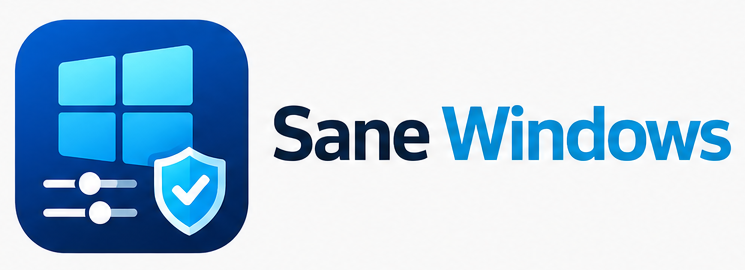
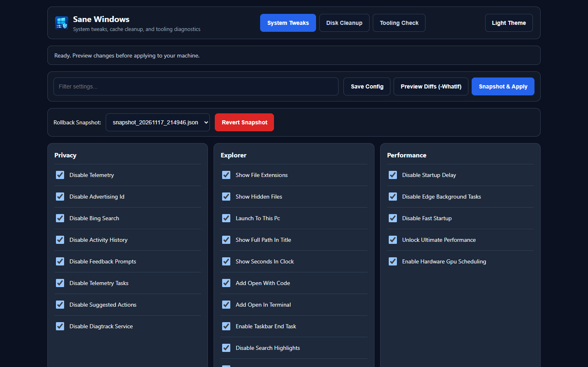

  

# Sane Windows

**Snapshot-safe Windows 10 and 11 privacy tweaks, cache cleanup, and developer tool diagnostics.**

Sane Windows gives you a visual control panel for privacy policies, File Explorer defaults, taskbar clutter, temporary cache cleanup, and developer CLI checks without hand-editing the Windows Registry or remembering PowerShell flags. Every tweak session saves an automatic rollback snapshot first.

---

## Download

| Platform | Download | How to Install |
| :--- | :--- | :--- |
| **Windows** | [SaneWindows-Windows.exe](https://github.com/DontKwo/sane-windows/releases/latest/download/SaneWindows-Windows.exe) | [Windows Install Steps](docs/INSTALLATION.md#windows) |

Browse release notes on [All Releases](https://github.com/DontKwo/sane-windows/releases/latest).

---

## Screenshots

  

---

## How to Use

1. **Download `SaneWindows-Windows.exe`** from the table above and place it alongside your `config.yaml` profile folder.
2. **Review System Tweaks**: Toggle Windows 10 and 11 settings on or off and click **Preview Diffs (-WhatIf)** to inspect changes without editing your system.
3. **Snapshot & Apply**: Click **Snapshot & Apply** to save a local JSON backup before writing approved tweaks, or select a snapshot later and click **Revert Snapshot**.
4. **Disk Cleanup & Tooling**: Switch tabs to scan reclaimable caches safely or check installed developer tools (`git`, `uv`, `python`, `pnpm`, `npm`, `cargo`, `docker`, `wsl`).

---

## Key Features

- **Automatic Rollback Snapshots**: Captures Registry, Git, and terminal settings before every apply so changes stay reversible.
- **Dry-Run Previews**: Shows exact pending changes (`-WhatIf`) and cache sizes before touching a single file or Registry key.
- **Confirmation Prompts**: Guards system modifications, cache deletions, and tool installations behind explicit confirmation dialogs.
- **Open Source**: Transparent PowerShell scripts and desktop shell released under the [MIT License](LICENSE).

---

## Safety & Disclaimers

- **System Modification Warning**: Sane Windows modifies Windows Registry keys, services, File Explorer behavior, and system caches. Always run a dry-run preview first and keep rollback snapshots.
- **Official `main` Releases Only**: Only download executables from [DontKwo/sane-windows](https://github.com/DontKwo/sane-windows/releases/latest) (`main` branch). Never download forked builds unless you are certain they contain no malware; only the `main` release stream is maintained by the author, and I make no promises.
- **Windows SmartScreen Warnings**: Because `SaneWindows-Windows.exe` is published independently without a commercial code-signing certificate, Windows SmartScreen will likely flag it as unrecognized or unsafe. Bypassing those prompts is strictly at your own discretion; see [Windows Installation Guide](docs/INSTALLATION.md).
- **AS-IS Disclaimer**: Provided "AS IS" under the [MIT License](LICENSE) with zero warranty or liability. Use entirely at your own risk.

---

## Documentation

### User Documentation
- [User Guide](docs/USER_GUIDE.md)
- [Windows Installation Guide](docs/INSTALLATION.md)
- [Customization Reference](docs/CUSTOMIZATION.md)
- [Frequently Asked Questions](docs/FAQ.md)

### Developer Documentation
- [Developer Guide](docs/DEVELOPMENT.md)
- [Developer uv Installation](docs/UV_INSTALLATION.md)

### AI, Mathematical Proof & Technical Documentation
- [AI Agent Rules](AGENTS.md)

### Legal & Security Policies
- [Security Policy](SECURITY.md)
- [Third-Party Notices](THIRD_PARTY_NOTICES.md)
- [MIT License](LICENSE)
